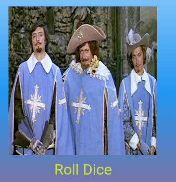

# Лабораторная работа №4-5. Flutter: структура UI и компонентный подход

**ФИО:** Сташевский Иван Иванович
**Группа:** ИС-21
**Дата сдачи:** 2026-10-16

## Что изучили

1. **Структуру Flutter-приложения и дерево виджетов** — как `MaterialApp`, `Scaffold`, `Container`, `Center` и `Text` вкладываются друг в друга и образуют иерархию интерфейса.
2. **Компонентный подход** — вынос виджетов в отдельные классы (`GradientContainer`, `StyledText`, `DiceRoller`) и файлы (`gradient_container.dart`, `styled_text.dart`, `dice_roller.dart`).
3. **Работу с ресурсами (assets)** — подключение изображений через `pubspec.yaml` и отображение их через `Image.asset`.
4. **Разницу между `StatelessWidget` и `StatefulWidget`** — управление состоянием через `setState()` для перерисовки интерфейса при действиях пользователя.
5. **Генерацию случайных чисел** и построение интерактивного UI — кнопка `TextButton`, обработчик `onPressed`, динамический путь к картинке через интерполяцию строк.

## Скриншот финального приложения



## Ссылка на репозиторий

https://github.com/vekysek12-wq/Flutter_Widgets.git

## Инструкция по запуску

1. Клонировать репозиторий:

   ```bash
   git clone https://github.com/username/Flutter_Widgets.git
   cd Flutter_Widgets
Установить зависимости:


   `flutter pub get`

Запустить приложение в Chrome:


`flutter run -d chrome`
Нажать кнопку `Roll Dice` — на экране появится случайная грань кубика от 1 до 6.

#### Ответы на вопросы
##### 1.  Зачем выносить виджеты в отдельные файлы? Что изменится, если держать всё в main.dart?
Вынос виджетов в отдельные файлы делает код модульным и читаемым: каждый виджет отвечает за свою часть интерфейса, его легко найти, изменить и переиспользовать в других местах приложения. Если держать всё в main.dart, файл быстро разрастается до сотен строк, становится сложно ориентироваться, появляются конфликты имён, а переиспользование виджета требует копирования кода. Разбивка на файлы — стандартная практика Flutter-разработки.

##### 2. Что такое BuildContext? Почему метод build() принимает его как параметр?
BuildContext — это объект, содержащий информацию о положении виджета в дереве виджетов. Flutter передаёт его автоматически при каждой перерисовке. Через BuildContext виджет получает доступ к родительским виджетам, теме приложения (Theme.of(context)), медиа-запросам (MediaQuery.of(context)), навигации (Navigator.of(context)) и другим данным. Без него виджет не сможет корректно встроиться в дерево и получить нужный контекст.

##### 3. Чем StatelessWidget отличается от StatefulWidget? Приведите пример, когда нужен каждый из них.
StatelessWidget — неизменяемый виджет: он отрисовывается один раз и не хранит состояние. Подходит для статичного UI (текст, фон, иконка).

StatefulWidget состоит из двух классов: сам виджет (DiceRoller) и объект состояния (_DiceRollerState). Состояние хранит изменяемые данные и может меняться через setState(), что вызывает перерисовку.

Пример StatelessWidget: GradientContainer — фон с градиентом, который не меняется.
Пример StatefulWidget: DiceRoller — кубик, который меняет картинку при нажатии кнопки.

##### 4. Почему Random() создаётся на уровне файла, а не внутри rollDice()?
Создание Random() внутри rollDice() при каждом нажатии кнопки порождает новый генератор случайных чисел. Это менее эффективно, чем переиспользование одного объекта. Один Random() на уровне файла создаётся один раз при запуске приложения и используется повторно, что экономит ресурсы и даёт корректную последовательность случайных чисел без пересоздания генератора.